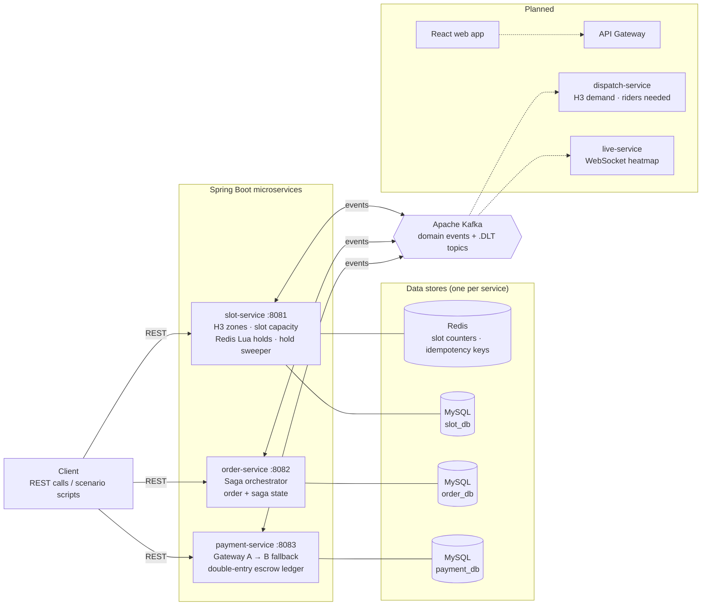

# SlotSure

Hyperlocal delivery-slot booking that never double-books a slot and never loses a rupee: atomic holds, an orchestrated saga, and an escrow ledger that always balances.

## The problem

Delivery slots are a scarce, time-boxed resource. When many customers in the same neighbourhood rush for the same evening slot, a naive "check then insert" oversells capacity. Payment adds a second failure point: the money can be captured while the slot is gone, or the slot confirmed while the payment failed. SlotSure keeps slot inventory and money consistent across three independent services without a distributed transaction.

## Architecture

diagram: docs/architecture.png

| Service | Port | Owns |
| --- | --- | --- |
| slot-service | 8081 | H3 zones, slots, Redis capacity counters, holds |
| order-service | 8082 | orders and the saga orchestrator |
| payment-service | 8083 | payment gateways, payment attempts, double-entry ledger |

Infrastructure (Docker): MySQL 8 (`localhost:3307`), Redis 7 (`localhost:6380`), Kafka in KRaft mode (`localhost:9092`), Kafka UI (`http://localhost:8090`).



## How it works

1. **Find slots** — `GET /api/slots?lat&lng&date`: slot-service maps the location to an H3 resolution-9 cell and returns that cell's 1-hour slots (08:00–22:00) with remaining capacity and a `GREEN` / `NORMAL` / `BUSY` price tag.
2. **Hold a slot** — `POST /api/holds`: a Redis Lua script atomically decrements the slot counter and creates a `HELD` reservation with an expiry; `409 SLOT_FULL` when nothing is left.
3. **Place the order** — `POST /api/orders` with the `holdId`: order-service stores a `PENDING` order and publishes `payment.requested` (saga step `PAYMENT_REQUESTED`).
4. **Take payment** — payment-service charges through a gateway, books the money into escrow in the double-entry ledger, and publishes `payment.captured` (or `payment.failed`).
5. **Confirm the slot** — order-service moves to `SLOT_CONFIRMING` and publishes `slot.confirm`; slot-service turns the hold `CONFIRMED` and replies `slot.confirmed`.
6. **Finish** — order-service marks the order `CONFIRMED`, saga step `DONE`. If any step fails, the saga goes `COMPENSATING`: it publishes `slot.release` and/or `refund.requested`, the hold becomes `RELEASED`, and the order ends `FAILED` or `CANCELLED`.

## Design decisions

- **Saga orchestration** — order-service drives every step explicitly, so the whole flow and its compensations live in one readable place.
- **Redis Lua atomic hold** — check-and-decrement runs as one script inside Redis, so concurrent holds can never oversell a slot.
- **Idempotent consumers** — each consumer records the `eventId` in `processed_events` in the same transaction as the business change, making Kafka redelivery harmless.
- **Gateway Strategy with fallback** — payment gateways sit behind one Strategy interface; if the primary fails, the next gateway is tried.
- **Double-entry escrow ledger** — every money movement is a balanced debit/credit pair, and `/api/ledger/check` proves the books sum to zero.
- **H3 zones** — Uber H3 resolution-9 hexagons give uniform, neighbourhood-sized zones for slot capacity.

## How to run

Prerequisites: Docker Desktop, Java 17, Maven.

```bash
# 1. Start infrastructure and wait until every container is healthy
docker compose up -d
docker compose ps

# 2. Build all three services
mvn clean verify

# 3. Run each service (separate terminals, or from IntelliJ)
mvn -f slot-service/pom.xml spring-boot:run
mvn -f order-service/pom.xml spring-boot:run
mvn -f payment-service/pom.xml spring-boot:run

# 4. Walk the happy path with requests.http (IntelliJ HTTP Client)
```

Run the scenarios (Node 18+, services running): `node scripts/scenarios.mjs happy|idem|fail|ledger` — `fail` needs payment-service started with `--slotsure.gateway.a.failure-rate=1.0 --slotsure.gateway.b.failure-rate=1.0`.

Kafka UI: http://localhost:8090. Stop with `docker compose down` (add `-v` to wipe MySQL and Kafka data).

## Test scenarios

Run on 2026-11-26 against the Docker infrastructure, all three services on the host. Slot used: Bengaluru (12.9716, 77.5946), H3 cell `8960145b483ffff`, 08:00–09:00 tomorrow, capacity 10.

| # | Scenario | Result |
| --- | --- | --- |
| 1 | Happy path: slots → hold → order (499.00) | ✅ Order `PENDING` → `CONFIRMED`, saga step `DONE` in ~1 s; hold `CONFIRMED`; slot remaining 10 → 9. Gateway A declined, gateway B captured (fallback exercised). Ledger: debit `CUSTOMER` 499 / credit `ESCROW` 499; check difference = 0 |
| 2 | Same hold request twice with one `Idempotency-Key` | ✅ Both calls returned 201 with the same `holdId` and `expiresAt`; remaining dropped by 1 only (9 → 8) |
| 3 | Payment failure (`slotsure.gateway.a.failure-rate=1.0`, `slotsure.gateway.b.failure-rate=1.0`) | ✅ Gateways A and B both declined; order `FAILED`, saga step `DONE`; hold `RELEASED` (compensation via `slot.release`); slot remaining back to its value before the hold (8 → 8); no ledger entries for the order |
| 4 | Ledger check after all runs | ✅ `totalDebit` 998 = `totalCredit` 998, `difference` 0 (2 captured orders, 2 failed orders) |
| 5 | Concurrency: 500 simultaneous holds on one slot with 3 places (`HoldFlowIntegrationTest`, real Redis + MySQL) | ✅ Exactly 3 holds succeeded, 497 got `409 SLOT_FULL`, 0 other errors, Redis counter ended at 0 (no oversell) |
| 6 | Hold expiry | ✅ Unpaid hold from #2 was `RELEASED` by the sweeper after 5 min and its place returned to the slot |

## Known limitations

- **Dual write** — services write to MySQL and then publish to Kafka separately; a crash between the two can lose an event until a Transactional Outbox is added.
- **Single Kafka broker** — replication factor 1, no fault tolerance.
- **Not built yet** — no API gateway, no demand heatmap, no WebSocket live updates, no UI.

## Roadmap

- Transactional Outbox for every event publish
- API gateway in front of the three services
- Demand heatmap per H3 cell
- WebSocket push of slot availability
- Customer-facing UI

---

© 2026 Rajasree Singamsetty. All rights reserved.
