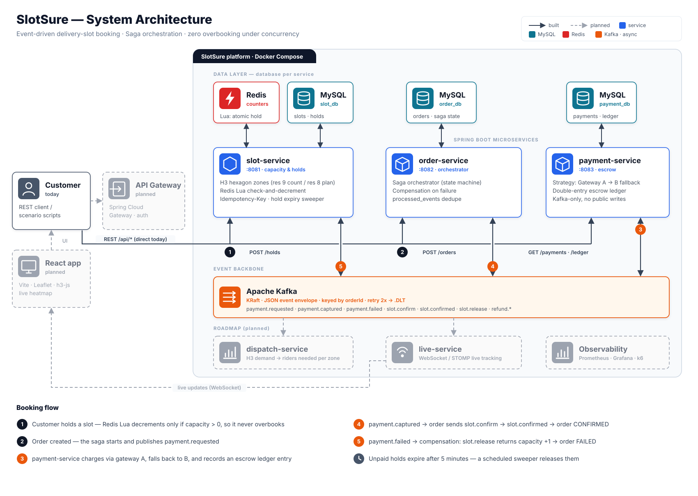

# SlotSure

Hyperlocal delivery-slot booking that never double-books a slot and never loses a rupee: atomic holds, an orchestrated saga, agent dispatch, and an escrow ledger that always balances.

## The problem

Delivery slots are a scarce, time-boxed resource. When many customers in the same neighbourhood rush for the same evening slot, a naive "check then insert" oversells capacity. Payment adds a second failure point: the money can be captured while the slot is gone, or the slot confirmed while the payment failed. Customers also pay in different ways — prepaid at checkout, online while booking, or cash at the door — and each needs the seller paid exactly once, after delivery. SlotSure keeps slot inventory, deliveries and money consistent across four independent services without a distributed transaction.

## Architecture

| Service | Port | Database | Owns |
| --- | --- | --- | --- |
| slot-service | 8081 | slot_db | H3 zones and area names, slots, Redis capacity counters, holds |
| order-service | 8082 | order_db | purchases, orders, the saga orchestrator, customer notifications |
| payment-service | 8083 | payment_db | payment gateways, payment attempts, double-entry ledger, settlement |
| dispatch-service | 8084 | dispatch_db | delivery agents and assignments |
| mobile (Expo) | 8088 | — | customer app and admin dashboard |

Infrastructure (Docker): MySQL 8 (`localhost:3307`), Redis 7 (`localhost:6380`), Kafka in KRaft mode (`localhost:9092`), Kafka UI (`http://localhost:8090`).



The shared rules every service follows — ports, Kafka topics and payloads, REST shapes, statuses — are in [CONTRACT.md](CONTRACT.md), including the V2 addendum.

## How it works

1. **A purchase is waiting** — `GET /api/purchases?customerId=`: the customer has bought items at checkout, each `PREPAID` or `COD`, and each `AWAITING_SLOT`. A customer seen for the first time gets three starter purchases.
2. **Find slots** — `GET /api/slots?lat&lng&date`: slot-service maps the location to an H3 resolution-9 cell, names its area (the nearest of ten Bengaluru localities to the cell's resolution-8 parent), and returns 1-hour slots (08:00–22:00) with remaining capacity and a `GREEN` / `NORMAL` / `BUSY` price tag.
3. **Hold a slot** — `POST /api/holds`: a Redis Lua script atomically decrements the slot counter and creates a `HELD` reservation with a 5-minute expiry; `409 SLOT_FULL` when nothing is left.
4. **Book it** — `POST /api/orders` with the purchase, the hold and a `paymentChoice`. The amount always comes from the purchase. order-service stores a `PENDING` order and starts the saga for that choice:

   | Purchase | paymentChoice | At booking | On delivery |
   | --- | --- | --- | --- |
   | PREPAID | `PREPAID` | no payment — `slot.confirm` straight away | `escrow.release` |
   | COD | `ONLINE` | `payment.requested` → gateway A, B as fallback → `payment.captured` → `slot.confirm` | `escrow.release` |
   | COD | `CASH` | no payment — `slot.confirm` straight away | `cod.collect` |

   Any other pairing is rejected with `400 INVALID_PAYMENT_CHOICE`; a second live order for the purchase with `409 ALREADY_SCHEDULED`.
5. **Confirm the slot** — slot-service turns the hold `CONFIRMED` and publishes `slot.confirmed` with the area, date and hours. order-service marks the order `CONFIRMED` and the purchase `SCHEDULED`.
6. **Dispatch** — dispatch-service also consumes `slot.confirmed` and gives the order to the least-loaded active agent based in that area with room in that hour (6 deliveries per agent per hour), otherwise the least-loaded agent elsewhere. It publishes `delivery.assigned`; the order goes `OUT_FOR_DELIVERY`.
7. **Deliver** — `POST /api/deliveries/{orderId}/complete` on dispatch-service publishes `delivery.completed`. order-service marks the order `DELIVERED` and asks payment-service to pay the seller: `escrow.release` moves the money from `ESCROW` to `MERCHANT` (recording the checkout capture first for a PREPAID order), `cod.collect` books the agent's cash from `CASH_COLLECTED` to `MERCHANT`.
8. **Compensate** — if payment fails, the saga publishes `slot.release`, the hold becomes `RELEASED`, the order ends `FAILED`, and the purchase goes back to `AWAITING_SLOT` so the customer can try again or choose cash. If the hold expires after an online payment, `refund.requested` returns the money and the order ends `CANCELLED`.

Each milestone (`SLOT_CONFIRMED`, `AGENT_ASSIGNED`, `DELIVERED`, `PAYMENT_FAILED`) creates a customer notification in the same transaction as the status change; the app polls `GET /api/notifications` and shows them as local notifications.

## Design decisions

- **Saga orchestration** — order-service drives every step explicitly, so each payment choice and its compensations live in one readable place.
- **Redis Lua atomic hold** — check-and-decrement runs as one script inside Redis, so concurrent holds can never oversell a slot.
- **Idempotent consumers** — each consumer records the `eventId` in `processed_events` in the same transaction as the business change, making Kafka redelivery harmless. Settlement is idempotent twice over: an order whose `MERCHANT` leg exists is never paid again.
- **Optimistic locking on orders** — `slot.confirmed` and `delivery.assigned` arrive on different topics and can be handled at the same moment; the losing transaction fails on the version check and the Kafka retry re-reads the order instead of overwriting it.
- **Tolerant readers** — every consumer ignores unknown JSON fields, so a producer can add fields without breaking anyone.
- **Gateway Strategy with fallback** — payment gateways sit behind one Strategy interface; if the primary fails, the next gateway is tried.
- **Double-entry escrow ledger** — every money movement is a balanced debit/credit pair, and `/api/ledger/check` proves the books sum to zero.
- **H3 zones** — Uber H3 resolution-9 hexagons give uniform, neighbourhood-sized zones for slot capacity; resolution-8 parents give stable area names.
- **Shared demo plan** — order-, payment- and dispatch-service derive their demo data from the same date-seeded plan (pinned by a fingerprint test in each), so demo orders, payments and agent assignments agree and can be driven end to end.

## How to run

Prerequisites: Docker Desktop, Java 17, Maven, Node 18+ (for the app).

```bash
# 1. Start infrastructure and wait until every container is healthy
docker compose up -d
docker compose ps

# 2. Build all four services
mvn clean verify

# 3. Run each service (separate terminals, or from IntelliJ)
mvn -f slot-service/pom.xml spring-boot:run
mvn -f order-service/pom.xml spring-boot:run
mvn -f payment-service/pom.xml spring-boot:run
mvn -f dispatch-service/pom.xml spring-boot:run

# 4. Walk the flows with requests.http (IntelliJ HTTP Client)
```

Run the scenarios (Node 18+, all four services running): `node scripts/scenarios.mjs prepaid|cash|online|idem|invalid|ledger|all`. Each books, delivers and settles one order as demo customer user1 and prints a `RESULT` line. `fail` needs payment-service started with `--slotsure.gateway.a.failure-rate=1.0 --slotsure.gateway.b.failure-rate=1.0`. The demo user's purchases are topped up when order-service starts, so restart it after a few runs.

An existing MySQL volume does not rerun `infra/mysql/init.sql`; create the new database once:

```bash
docker exec -it slotsure-mysql mysql -uroot -proot -e "CREATE DATABASE IF NOT EXISTS dispatch_db; GRANT ALL ON dispatch_db.* TO 'slotsure'@'%'; FLUSH PRIVILEGES;"
```

**Mobile app** (`mobile/`, Expo):

```bash
cd mobile
npm install
# Your PC's LAN IP, so a phone on the same Wi-Fi can reach the services
# (cmd syntax; in PowerShell use $env:EXPO_PUBLIC_API_HOST="192.168.1.20")
set EXPO_PUBLIC_API_HOST=192.168.1.20
# Optional: Google Maps key with the Maps SDK, Places API and Geocoding API enabled
set EXPO_PUBLIC_GOOGLE_MAPS_KEY=...
npx expo start --port 8088
```

Log in with a demo chip: `user1@slotsure.demo`, `user2@slotsure.demo`, `user3@slotsure.demo` (customers, each topped up with one PREPAID and two COD purchases on every order-service start) or `admin@slotsure.demo` (admin dashboard). Any other email becomes a new customer. Notifications are polled every 15 s while the app is open; push to a closed app needs a development build with FCM, not Expo Go.

**Demo data** — with `slotsure.demo-data.enabled: true` (the default in every service), each service seeds today and yesterday on startup if that date has no demo rows yet: 40–80 bookings a day across the ten areas, peaking 18:00–21:00, about 35% cash on delivery, a few failed, 12 agents. Seeded rows have `demo = 1` and can be deleted.

Kafka UI: http://localhost:8090. Stop with `docker compose down` (add `-v` to wipe MySQL and Kafka data).

## Test scenarios

### V2 end to end

Run on 2026-11-29 against the Docker infrastructure, all four services on the host, as demo customer user1. Slots: Koramangala (12.9352, 77.6245), tomorrow, 18:00–21:00.

| # | Scenario | Result |
| --- | --- | --- |
| 1 | Purchases for user1 | ✅ 1 PREPAID and 2 COD purchases `AWAITING_SLOT` |
| 2 | PREPAID booking | ✅ 201 `PENDING`, no payment step; `CONFIRMED` with areaName `Koramangala`; `OUT_FOR_DELIVERY` with agent Ravi Kumar within 10 s |
| 3 | COD paid in `CASH` | ✅ `OUT_FOR_DELIVERY`; payment-service has no payment for the order (`404 PAYMENT_NOT_FOUND`) |
| 4 | COD paid `ONLINE` | ✅ Captured by gateway A into escrow; `OUT_FOR_DELIVERY` |
| 5 | PREPAID purchase with `ONLINE` | ✅ `400 INVALID_PAYMENT_CHOICE` |
| 6 | Mark all three delivered (twice each) | ✅ `200`, same `deliveredAt` on the repeat; all `DELIVERED` |
| 7 | Settlement | ✅ PREPAID: checkout capture `CUSTOMER → ESCROW`, then `ESCROW → MERCHANT`. ONLINE: `ESCROW → MERCHANT`. CASH: `CASH_COLLECTED → MERCHANT` plus a `COD` / `COLLECTED` payment. Ledger difference 0 |
| 8 | Notifications | ✅ `SLOT_CONFIRMED`, `AGENT_ASSIGNED`, `DELIVERED` for every order, e.g. "Slot confirmed — Air Fryer 4L arrives Mon 30 Nov, 6–7 PM"; `?after=` returns only newer ones; mark read `204` |
| 9 | Per-customer data | ✅ user2's `/api/orders` contains none of user1's orders |
| 10 | Admin endpoints for today | ✅ All six return data: order summary and orders, slot utilisation, dispatch, agents, payments (ledger difference 0) |

### Core guarantees

| # | Scenario | Result |
| --- | --- | --- |
| 11 | Concurrency: 500 simultaneous holds on one slot with 3 places (`HoldFlowIntegrationTest`, real Redis + MySQL) | ✅ Exactly 3 holds succeeded, 497 got `409 SLOT_FULL`, 0 other errors, Redis counter ended at 0 (no oversell) |
| 12 | Same hold request twice with one `Idempotency-Key` | ✅ Same `holdId` and `expiresAt`; the counter dropped once |
| 13 | Hold expiry | ✅ An unpaid hold is `RELEASED` by the sweeper after 5 min and its place returns to the slot |
| 14 | Payment failure on both gateways (`scenarios.mjs fail`, payment-service started with both failure rates at 1.0) | ✅ Gateways A and B both declined; order `FAILED`, saga step `DONE`; purchase back to `AWAITING_SLOT`; `PAYMENT_FAILED` notification; no ledger entries |

Unit tests: slot-service 68 (plus 6 integration tests with `-Dgroups=integration`), order-service 63, payment-service 28, dispatch-service 24.

## Known limitations

- **Dual write** — services write to MySQL and then publish to Kafka separately; a crash between the two can lose an event until a Transactional Outbox is added.
- **Single Kafka broker** — replication factor 1, no fault tolerance.
- **No authentication** — demo customers and the admin role exist only in the app; the APIs are open.
- **Polling, not push** — the app polls for notifications; remote push needs FCM and a development build.
- **Schema by Hibernate** — `ddl-auto: update` creates and extends tables but never changes an existing column; schema migrations are still to come.

## Roadmap

- Transactional Outbox for every event publish
- Authentication and an API gateway in front of the four services
- Remote push notifications (FCM)
- Demand heatmap per H3 cell
- WebSocket push of slot availability and agent location

---

© 2026 Rajasree Singamsetty. All rights reserved.
